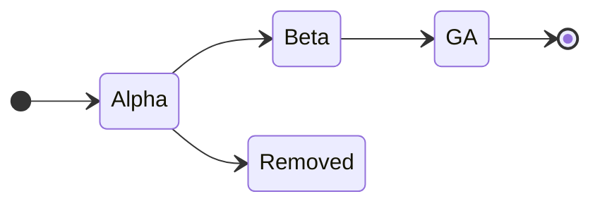

# RFC05: Feature gates

## Background

kubecfg has a single switch for everything that isn't stable yet: `--alpha` (or `KUBECFG_ALPHA=true`).
Today it gates eight separate things:

| What | Where it's checked |
| --- | --- |
| the `eval` command | `cmd/eval.go` |
| the `traceback` command | `cmd/traceback.go` |
| the `pack` command | `cmd/pack.go` |
| the `httpd` command | `cmd/httpd.go` |
| `--overlay-code`, `--overlay-code-file` (and the deprecated `--overlay`) | `cmd/root.go` |
| YAKL: `.yakl` files, `yakl:` imports, `yaklfmt`, `eval -o jsonnet` | `utils/importer.go`, `cmd/yaklfmt.go` |
| `kustomize+https://` imports | `utils/kustomize.go` |
| the `binary://` import prefix (deprecated in favour of `importbin`) | `utils/importer.go` |

One switch for all of them has a few problems:

1. **All or nothing.** Someone who only wants `pack` also gets YAKL, `httpd` and every alpha feature
   added in future releases. Upgrading kubecfg can then change what `--alpha` turns on, without anyone asking.
2. **No sense of maturity.** `eval` has been around for years and is used throughout the docs.
   YAKL was renamed and changed meaning last week. Both show up as "alpha".
3. **No way to graduate.** A feature can only go from "behind `--alpha`" to "always on" in one step.
   There's no stage where it's on by default but can still be turned off if it causes trouble.
4. **The error messages drift.** `pack` and `traceback` both say "eval is an alpha feature".
   Each check is written by hand.

## Goals

* Turn features on and off one at a time.
* Give each feature a stage (alpha, beta, GA) that says how far along it is, and lets it move forward
  by changing one line in a table, not by editing every place that checks it.
* Keep every existing command line, env var and script working. This includes `--alpha`.
* Make it easy for a project to say which features it relies on. This is where [RFC02](https://github.com/kubecfg/kubecfg/pull/224) comes in.

## Non-goals

* Changing the meaning of files that already work. Feature gates are for things that are *new*.
  Changes in the meaning of existing input need editions; see [Follow-ups](#follow-ups).
* Remote config, percentage rollouts, or anything a feature-flag service would do. These are
  build-time switches for a CLI.

## Concepts

### Feature

A feature is an entry in a registry compiled into kubecfg:

| Field | Example | Meaning |
| --- | --- | --- |
| name | `yakl` | Stable identifier, lowercase kebab-case. Never reused, never renamed. |
| stage | `alpha` | Where the feature is in its lifecycle. |
| since | `v0.40.0` | The release in which it entered its current stage. |
| doc | `YAML with Jsonnet expressions` | One line for `--help` and `kubecfg features`. |

### Stages



| Stage | Default | Can turn on | Can turn off | Gate checks in code | Compatibility promise |
| --- | --- | --- | --- | --- | --- |
| **alpha** | off | yes | yes | yes | none: behaviour can change or the feature can go away |
| **beta** | on | yes | yes | yes | full |
| **GA** | on | yes (no-op) | no | removed | full |
| **removed** | n/a | warning, no-op | warning, no-op | removed | n/a |

* **Alpha** is off unless someone asks for it. Anything can change between releases, as YAKL did
  when it was renamed from jamlet.
* **Beta** is on by default, so people use it without having asked for it. From this point the
  feature gets kubecfg's full compatibility promise: its behaviour can only change by adding
  things. The off switch is there so a user who hits a problem can go back while it's fixed.
* **GA** is just "the feature". The `if enabled(...)` checks are deleted from the code. The name
  stays in the registry forever, so command lines and rc files that mention it keep working.
* **Removed** is for alpha features that didn't work out. The name stays in the registry as a
  tombstone: setting it prints a warning instead of failing, and the name is never reused.

Only alpha features can be removed. A beta feature has been on for everyone, so removing it
would break people who never opted in.

### Which features can go to beta

Beta means "on by default": everyone gets it on upgrade, without asking. That's only safe if
turning the feature on can't change the result of anything that worked before.

* **Additive features** can follow alpha → beta → GA. They add something that used to be an
  error: a new command, a new flag, a new import scheme, a new file extension, a new standard
  library function. Every gate in the table above is additive.
* **Semantic features** change what existing, valid input means: how objects merge, the order
  objects are applied in, how `show` formats output. They can have an alpha gate, so people can
  try them, but they must never reach beta through a feature gate. Their way to graduate is an
  edition (see [Follow-ups](#follow-ups)).

The registry records which kind each feature is. A test fails if a semantic feature is set to beta or GA.

### Lifecycle rules

* **Alpha → beta:** docs are written, no breaking changes are planned, and it has been used
  for real for at least one release.
* **Beta → GA:** at least one release in beta with no reports that needed the off switch.
* Moving a feature forward is a one-line change in the registry, plus release notes.

## UX

### Turning features on and off

A new global flag, `--features`, takes a comma-separated list. It can be repeated.

```console
$ kubecfg show --features=yakl app.yakl
$ kubecfg show --features=yakl,knit app.yakl
$ kubecfg show --features=yakl --features=knit app.yakl     # same as above
$ kubecfg show --features=knit=false app.jsonnet            # turn off a beta feature
```

* `name` and `name=true` turn a feature on, and `name=false` turns it off.
* Settings for different features combine; a later setting for the same feature wins.
* The env var follows the existing `KUBECFG_` prefix: `KUBECFG_FEATURES=yakl,knit`. It's another way to
  set the flag, so, as with every kubecfg flag, `--features` on the command line replaces it.

### What happens with each kind of name

| You set | Result |
| --- | --- |
| an alpha or beta feature | as asked |
| a GA feature, `=true` | accepted, logged at debug level |
| a GA feature, `=false` | error: `knit is GA since v0.45.0 and can no longer be turned off; remove "knit=false" from --features` |
| a removed feature | warning: `binary-import was removed in v0.42.0; ignoring` |
| an unknown name | error: `unknown feature "knti"; run "kubecfg features" to list them` |

An unknown name is an error, not a warning, so a typo doesn't silently leave a feature off.
An rc file written for a newer kubecfg fails the same way on an older kubecfg, which is what
should happen: the project needs something that release doesn't have.

### `--alpha` stays

`--alpha` and `KUBECFG_ALPHA` keep their meaning: turn on every alpha feature. To keep that
exact behaviour, `--alpha` also turns on alpha features added in future releases.

A setting that names a feature beats one that doesn't, so `--alpha --features=httpd=false` turns
on everything alpha except `httpd`.

The docs move from `kubecfg --alpha ...` to `--features=...`. `--alpha` stays supported forever, but
the docs stop recommending it, since it's the thing that changes under you on upgrade.

### Precedence

For each feature, the first source that names it wins:

1. `--features` (or `KUBECFG_FEATURES`)
2. the rc file (RFC02)
3. `--alpha` (or `KUBECFG_ALPHA`; alpha features only)
4. the stage's default

Note that this works per feature, which is different from how a plain flag works. With a plain
flag, a value on the command line replaces the value from the rc file. With `--features`,
`--features=pack` on the command line adds `pack` to the rc file's `yakl`; it doesn't replace it.

### Seeing what's on

```console
$ cat .kubecfgrc.jsonnet
{ flags+: { features+: { yakl: true } } }
$ kubecfg features --alpha --features=httpd=false
NAME              STAGE  DEFAULT  ENABLED  SOURCE              SINCE
eval              alpha  off      on       --alpha             v0.40.0
traceback         alpha  off      on       --alpha             v0.40.0
pack              alpha  off      on       --alpha             v0.40.0
httpd             alpha  off      off      --features          v0.40.0
overlay           alpha  off      on       --alpha             v0.40.0
yakl              alpha  off      on       .kubecfgrc.jsonnet  v0.40.0
kustomize-import  alpha  off      on       --alpha             v0.40.0
binary-import     alpha  off      on       --alpha             v0.40.0
```

SOURCE is the place that decided the setting, from the list under [Precedence](#precedence). This
answers "why is this feature off?" without guessing. An env var shows as its flag: `KUBECFG_ALPHA`
shows as `--alpha`, because it is another way to set that flag.

`-o json` gives the same table as data. The docs page listing all features is generated from the
registry, so it can't get out of date.

### Error messages

Every gate check produces the same kind of error, generated from the registry:

```console
$ kubecfg show app.yakl
ERROR app.yakl: yakl is an alpha feature; turn it on with --features=yakl
```

## Migration

The first release with feature gates registers the eight features above, all at **alpha**. On that
day nothing behaves differently: `--alpha` turns on the same things, and nothing is on without it.

| Name | Gates | Kind | Notes |
| --- | --- | --- | --- |
| `eval` | `kubecfg eval` | additive | used throughout the docs; first candidate for beta |
| `traceback` | `kubecfg traceback` | additive | |
| `pack` | `kubecfg pack` | additive | |
| `httpd` | `kubecfg httpd` | additive | |
| `overlay` | `--overlay-code`, `--overlay-code-file`, `--overlay` | additive | |
| `yakl` | `.yakl` files, `yakl:` imports, `yaklfmt`, `eval -o jsonnet` | additive | still changing; stays alpha for a while |
| `kustomize-import` | `kustomize+https://` imports | additive | |
| `binary-import` | `binary://` import prefix | additive | already deprecated in favour of `importbin`; candidate for removed |

Moving any of them to beta is a separate decision, made one feature at a time in later releases.

## Implementation sketch

A small package, `pkg/features`:

```go
package features

type Stage int

const (
	Alpha Stage = iota
	Beta
	GA
	Removed
)

type Kind int

const (
	Additive Kind = iota
	Semantic
)

type Feature struct {
	Name  string
	Stage Stage
	Kind  Kind
	Since string
	Doc   string
}

var (
	Eval = register(Feature{Name: "eval", Stage: Alpha, Since: "v0.40.0", Doc: "the eval command"})
	YAKL = register(Feature{Name: "yakl", Stage: Alpha, Since: "v0.40.0", Doc: "YAML with Jsonnet expressions"})
	// ...
)

// Source is one place features are set from: --features, or the rc file.
type Source struct {
	Name  string   // shown in kubecfg features and in errors
	Items []string // "name", "name=true" or "name=false"
}

// Gates is the set of enabled features for one kubecfg invocation, with where each setting came from.
type Gates struct{ /* ... */ }

// New resolves every feature: the first source that names it wins, then alpha, then the default.
func New(alpha bool, sources ...Source) (*Gates, error)

func (g *Gates) Enabled(f *Feature) bool

// Require returns the standard "X is an alpha feature; turn it on with --features=X" error.
func (g *Gates) Require(f *Feature) error
```

* `cmd/root.go` builds one `Gates` from `--features` (which viper already merges with
  `KUBECFG_FEATURES`), the rc file and `--alpha`, and passes it down. `Gates` applies the
  precedence itself, so it knows which source decided each feature; that is the SOURCE column.
* The `alpha bool` that goes through `kubecfg.WithAlpha`, `utils.MakeUniversalImporter` and
  `kustomizeImporter` becomes a `*features.Gates`. These are exported Go functions that other
  programs may call, so the old signatures stay as wrappers. `WithAlpha(true)` means "turn on
  all alpha features", exactly as `--alpha` does.
* `wasm/cmd/kubecfg-show` has its own `--alpha` flag; it gets `--features` too, using the same package.
* Tests:
  * Every feature is listed in the docs page.
  * No two features share a name.
  * A GA feature has no `Enabled` calls left. This is checked by searching the source for its variable.
  * No semantic feature is beta or GA.

### Why not `k8s.io/component-base/featuregate`

Kubernetes has a feature gate package with the same alpha/beta/GA model and a `--feature-gates=Name=true`
flag. It would be a reasonable base, and kubecfg already depends on parts of Kubernetes. Reasons to
write our own (about 200 lines):

* its flag syntax is CamelCase names in a map (`Foo=true,Bar=false`), which doesn't match kubecfg's kebab-case flags;
* it has no notion of a bulk switch like `--alpha`;
* it doesn't record where each setting came from, which `kubecfg features` needs;
* it has no tombstones for removed names, and no additive/semantic distinction.

This is an open question; see below.

## Relationship with RFC02 (Flags From Files)

[RFC02](https://github.com/kubecfg/kubecfg/pull/224) lets a project check in a `.kubecfgrc.jsonnet`
that sets default flag values. `--features` is a flag, so it fits in directly, and this is the main
way a project says what it relies on:

```jsonnet
// .kubecfgrc.jsonnet
{
  flags+: {
    features+: { yakl: true, knit: true },
  },
}
```

With this file checked in, every contributor and every CI job gets the same features with a plain
`kubecfg show`. No wrapper scripts, and no `--alpha` that turns on more than the project needs.

What RFC02 needs for this to work:

* **An object value for `features`.** The RFC02 prototype turns arrays into repeated flag values and
  everything else into a string. `features` should accept both an array (`['yakl', 'knit']`) and an
  object (`{yakl: true, knit: false}`). The object form is better, because overlays can change one
  feature (`features+: {knit: false}`).
* **Per-feature merging.** As described under [Precedence](#precedence), the rc file's features and
  the command line's are combined feature by feature. RFC02's general rule (a value on the command
  line replaces the default) doesn't apply to this one flag. So the rc file's `features` can't just
  become the flag's default value, or `--features=pack` would replace the rc file's `yakl`. RFC02
  has to hand them to `features.New` as a source of their own.
* **Global, not per command.** RFC02 allows settings under `commands.show`, `commands.update` and so
  on. Features should only be set under `flags`. If `show` had `knit` and `update` didn't, `show`
  would print something different from what `update` applies. kubecfg rejects `features` under `commands`.
* **The rc file is evaluated with default gates.** The rc file decides the features, so its own
  evaluation can't depend on them. It's a plain `.jsonnet` file evaluated with every gate at its default.
* RFC02's rule that all input files must resolve to the same rc file applies as it is. Features
  are a property of one invocation.

This RFC doesn't depend on RFC02: `--features` and `KUBECFG_FEATURES` work on their own, and the rc
file support lands with RFC02.

## Follow-ups

These aren't part of this RFC, but they show where feature gates fit.

### Editions

Feature gates are per invocation: one set of features for the whole run. That's right for additive
features, but it can't handle changes in meaning, for two reasons:

* a semantic change must never become the default for files that didn't ask for it;
* a library imported from somewhere else must keep the meaning it was written for, whatever the
  importing project turns on.

Those need editions: the language version is decided for each file or module, not for each run. Go
does this with the `go` line in `go.mod`. The nearest `go.mod` above a file decides its language
semantics; that's how Go 1.22 changed loop variables without breaking older modules. kubecfg could
find the edition the same way, from the nearest rc-like file above each imported file. For an OCI
bundle, the edition would come from the bundle's metadata, and for a plain `https://` import it
would default to the oldest edition.

The two fit together: an alpha feature gate is how people try a semantic change early, and an edition
is how it ships. The gate never goes to beta.

### knit

The keyed-array overlay merge (`kubecfg.knit`) is the first feature born under this system. It adds
a new namespace to the standard library and changes nothing that exists, so it's additive and can
follow alpha → beta → GA.

### An implicit `kubecfg` local

Making the standard library available as `kubecfg` without an explicit import is additive: a free
`kubecfg` variable is a static error today, so no working file can depend on its absence. It can
start as an alpha feature (`implicit-stdlib`). It needs a small go-jsonnet change, letting the
embedding program add globals the way `std` is added. Adding the text to the start of each file
would change what `importstr` returns for `.jsonnet` files.

### Caching and vendoring (RFC03)

`--cache-dir`, `--ci` and the pruning options in [RFC03](https://github.com/kubecfg/kubecfg/pull/235)
are ordinary flags, set through RFC02. Vendoring itself could ship as an alpha feature, `vendoring`.

### OCI bundles

A bundle made with `kubecfg pack` may need features to evaluate, for example a bundle containing YAKL.
`pack` could record the features it was built with in the bundle's metadata, next to the kubecfg
version it already records. When importing, kubecfg would fail with a clear message listing the
missing features. It wouldn't turn them on by itself: remote code shouldn't be able to turn on alpha
features.

## Open questions

* **The flag's name.** `--features` is short and matches kubecfg's style. `--feature-gates` is what
  Kubernetes users know. One could be an alias of the other.
* **GA with `=false`.** This RFC proposes an error, since the user asked for something kubecfg can no
  longer do. A warning would be gentler, but it would silently do something other than what was asked.
* **How long in beta.** Is one release enough before GA?
* **Our own package or `component-base/featuregate`.** See above.
* **Should Jsonnet code see feature gates?** A library could want to say "this needs `knit`" with a
  clear error, e.g. `kubecfg.requireFeature('knit')`. Letting code read the gates (`if enabled then ... else ...`)
  would make output depend on flags in a way that's hard to see. Requiring a feature seems fine;
  reading one doesn't.
* **Does `--alpha` ever print a deprecation warning?** It can never be removed. A warning that
  suggests naming the features would push people toward pinning them.
